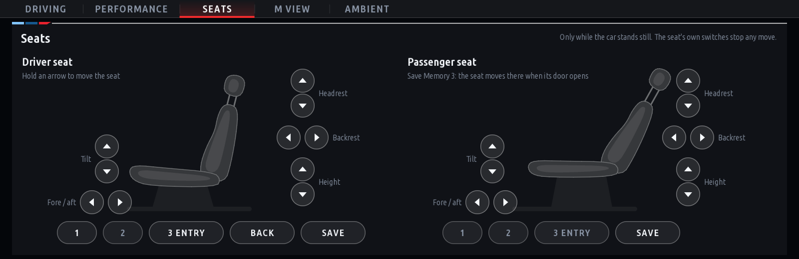
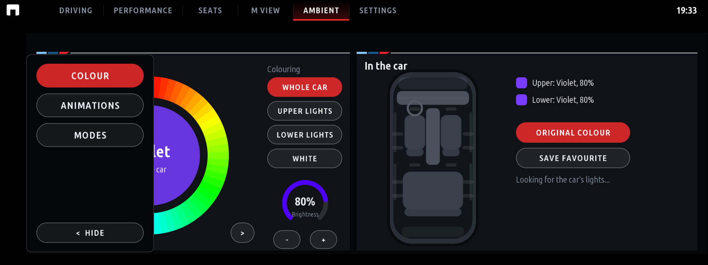
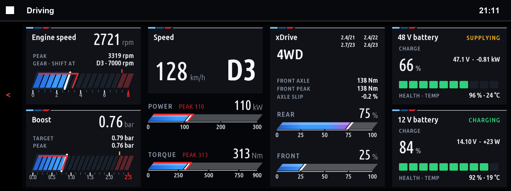
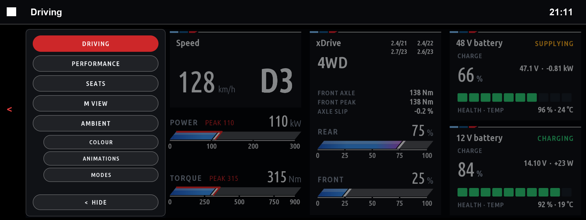

<h1 align="center">Combo</h1>

<p align="center">
  <b>Driving data, performance timing, engine health, seats and the ambient light: one app for the BMW MGU head unit (iDrive 7).</b><br>
  Drawn by its own GPU renderer at 60 fps; reads the car without changing anything in it.
</p>

<p align="center">
  
</p>

Combo puts the apps used most into tabs of one app, so the head unit runs one process and one diagnostic link instead
of several. It is this repository's only app: a fork of
[cauliflowermossgrape/idrive7-apps](https://github.com/cauliflowermossgrape/idrive7-apps), whose kit (renderer,
runtime, build tools) it is built with. The source repo's own guide (how the head unit works, building, writing your own
app) is in [KIT.md](KIT.md).

**Version 2.5.2.** Developed and tested on a G26 M440i xDrive (B58 with the 48 V mild hybrid, ZF 8HP).

---

## Contents

- [The tabs](#the-tabs)
- [Screen layouts and controls](#screen-layouts-and-controls)
- [Settings](#settings)
- [Install](#install)
- [What Combo reads, and what it doesn't do](#what-combo-reads-and-what-it-doesnt-do)
- [Reporting a problem: the QR log](#reporting-a-problem-the-qr-log)
- [Development](#development)
- [Credits and licences](#credits-and-licences)

---

## The tabs

### Driving

The car's live values in four columns of the same size, in M Vitals' look:

- **Engine speed and boost:** with their peaks, the gear and shift point, and the DME's boost target.
- **Speed, power and torque:** with peaks.
- **xDrive:** the mode, the rear / front split, the torque to the front axle (from the transfer case), the wheel slip
  front against rear, and each tyre's pressure and temperature (`2.7/9`). A tyre more than 0.2 bar under the car's
  target is shown in the warning colour.
- **The batteries:** the 48 V battery of a mild hybrid (charge, charging / supplying, voltage, power, health,
  temperature) over the 12 V battery (charge, voltage, power, health, temperature). A car without 48 V gives the
  column to the 12 V battery.

### Performance


- **Virtual Dyno:** a pull in one gear gives power and torque over rpm (from mass × acceleration × speed), with a
  baseline to compare against.
- **Drag timer:** waits for a standing start, then times the splits (0–50, 0–100, 100–200, 0–200 km/h, ¼ mile) and
  keeps your best times. Optional one-foot rollout.

### Seats



Combo finds the front seat modules (0x6D driver, 0x6E passenger on a G26) and draws each seat from the side: its
parts sit where the seat really is on its travel (forward / back, height, backrest, tilt, headrest), and a part that
moves lights up, also when the seat's own switches move it.

**Hold an arrow** by a part and that motor moves while you hold it; it stops the moment you let go or slide off, at the
end of its travel, or after 10 s. A press with the controller moves it for a moment.

Each seat has **memory 1 and 2**. Press **Save**, then a slot, to keep the seat's position there; press the slot to
go back to it.

**Easy entry** (Settings > Seats, on by default): press **Save**, then **Easy entry**, to keep the position for getting in
and out. When a front door opens, its seat moves there, after keeping where it was. Only a door opening moves it: nothing
happens when the engine starts or stops (start-stop at a light). **Back** takes it back to where it was. A move:

- runs only while the car stands still, on a seat module that reports itself initialised;
- stops at once when any seat switch is pressed, the seat is moved by hand, the car rolls, or **Stop** is pressed;
- keeps every target inside the end stops the seat module has learned, runs every motor that has to move at once (fewer
  if the module turns one away), and stops each motor itself: the module keeps a motor running until it is told to stop.

2.6.3 also listens (reading only) to BMW's own seat interfaces on the head unit: the memory buttons, the seat's memory
status and the car's own easy entry setting. The log shows whether the car lets an app hear them; if it does, a later
version can use the seat's own memory recall.

### M View


The engine's and gearbox's health at a glance:

- **Tyres:** pressure against the car's target, and temperature.
- **Temperatures:** engine oil, coolant, gearbox oil and intake air, each with its maximum this drive and a trace.
- **Misfires:** per cylinder this driving cycle, from the engine's own on-board monitors. *Reset misfires* counts
  from then on; nothing is cleared in the car.
- **Fuel trims and timing:** short and long-term fuel trim, and ignition advance. A long-term trim 10 % from zero
  is shown yellow, 20 % red.

### Ambient



Any colour on the ambient light, with animations and a look for each driving mode. This is Ambient config's code,
taken from the source repo at build time.

- **Colour:** the whole car or upper / lower lights separately, with brightness.
- **Animations:** moving scenes.
- **Modes:** a look for each driving mode (Sport, Comfort, Eco Pro, Adaptive).
- **Signals:** the turn signals blink the door lines at an even pace of their own, and an open door can show red.

The ambient light runs from the car's start with the app closed. With Ambient config installed too, the app started
first drives the lights and the other leaves them alone.

## Screen layouts and controls

Settings > Screen > **Screen layout** picks one of three:

| Layout | Looks like | Tabs | Reset, Settings |
|---|---|---|---|
| **Full screen** (default) | Combo draws the whole screen | in the header; Ambient's three pages in a side rail | a side rail on the left; Settings is the header's last tab |
| **Map style** | BMW's map: no tabs, the header names the page | a left side bar | a right side bar |
| **Standard** | BMW's own title and bottom bar | in the page | BMW's bottom bar, hidden 5 s after the last touch |

**Map style:** the cards use the whole height of the screen (no bar under them), and over the back arrow column too, so the left margin is the same as the right one (BACK and the home button still work). Nothing is drawn on the edges, as on BMW's map. An open bar covers one column and dims the rest of the page.




 

**Side bars, by touch:** a touch on the page's left or right edge opens that bar (full screen: on the slim handle). It hides again 5 s after the last touch.

**Side bars, with the iDrive controller:**

- Push **left** for the left bar, push **right** for the right bar (map style). The knob lands on the page you're on.
- Turn to move, press to choose.
- Push the other way to close it.
- A bar opened with the controller stays open until you close it or choose something.

**Elsewhere:** the controller moves along the tabs and the page's buttons as in BMW's own apps. BACK leaves the app.

## Settings


Five groups:

| Group | What it holds |
|---|---|
| **Gauges** | engine type, redline, rev scale, boost and torque scales, power and boost sources, peak markers and hold, xDrive card, 48 V battery |
| **Dyno & drag** | weight, body shape, drivetrain loss, the ECU torque overlay, the drag split, one-foot rollout |
| **Ambient light** | decor lights with upper or lower, night dimming, your colour back at each start, the car's own door warning, steering wheel side |
| **Units** | speed, pressure, power, torque, temperature |
| **Screen** | colour theme, layout, bottom bar (Standard), renderer, demo data |

**QR log** is at the bottom of Settings (see below).

## Install

You need:

- **A BMW with the MGU head unit (iDrive 7)**, with the MGU Store on it. Root access is needed to install the Store.
  This project does not provide it.
- **From the Store:** the GPU renderer (`idrive7-renderd`, 2.1.18 or newer) and the controller gate
  (`mgu-inputgate`, 1.1.0 or newer). Both come from the source repo.

Then add this repository to the MGU Store (it reads [`mgu-repo.json`](mgu-repo.json)) and install **Combo**. The Store
builds it from this repository's `main` branch, so a merged change is its next version. Combo starts with the car
(the ambient light needs it running) and shows up in *All apps*.

**Demo data** (Settings > Screen) is on while the car sends nothing, so the screens can be tried parked.

## What Combo reads, and what it doesn't do

- **Car signals** over SOME/IP: speed, rpm, gear, torque, temperatures, tyres, driving mode, doors, turn signals, and
  so on.
- **The diagnostic link, read-only:** Combo's link only lets reads out:
  - UDS `22` (read by identifier);
  - OBD `01`, `06` and `09` (current data, on-board monitor results, vehicle information).

  Anything else (sessions, writes, routines, clearing faults) is refused before it leaves the head unit, with one
  exception: the seat motors (below). It is used for the values the car doesn't send: front axle torque, battery
  details, gearbox oil, misfires, fuel trims, the seat positions.
- **Reads only while the tab that needs them is on screen,** and none once the car is locked and left, so a parked car
  can sleep.
- **The ambient light is the one thing written:** through the body module, as BMW's own menu does. *Original colour*
  gives the car its own colours back.
- **The seat motors are the one diagnostic write:** `2E D7 08 <motor> <action> <power>` to 0x6D and 0x6E only (the
  seat modules' `STEUERN ARG;MOTOR` job, as ISTA sends it: no session change, no security access), for the five motors
  a G26's seats have. Every other write is refused before it leaves the head unit.

## Load on the head unit

Each tab is drawn only as often as it needs (2.6.4; before, every tab was drawn 60 times a second with the GPU
renderer, a still one too): Driving and Performance at Settings > Screen > **Gauges frame rate** (30 by default; 15 is
the lightest, 60 the smoothest), Seats 10 times a second, M View 5, the ambient tabs only while they change. Once a
minute the log says the app's CPU share, its memory and how many frames it drew (`perf:` lines in the QR log).

## Reporting a problem: the QR log

Settings > **QR log** shows the app's recent log as a few QR codes. Photograph every page; the decoder turns the
photos back into the log:

```bash
pip install zxing-cpp pillow
```

```bash
python3 kit/tools/qrlog_decode.py photo1.jpg photo2.jpg ...
```

The log names what the car answered, which reads it refused, and the app's version.

## Development

The code is in [`apps/combo/`](apps/combo). The ambient light's code is in
[`shared/ambient_config/`](shared/ambient_config), and the kit is in [`kit/`](kit).

| File | What it does |
|---|---|
| `main.js` | the tabs, the layouts, the side bars |
| `draw.js` | the Driving tab |
| `perf.js` | Performance |
| `seats.js`, `seatmod.js`, `seatmove.js` | Seats (`seatmove.js`: memory and easy entry) |
| `mview.js` | M View |
| `signals.js` | the car's signals |
| `reads.js` | the diagnostic reads |
| `values.js` | values and peaks |
| `app.json` | settings, signals and read candidates |

Tests run with Node.js, no car needed:

```bash
node kit/tools/test_combo.js
```

```bash
node kit/tools/test_runtime.js
```

```bash
for t in kit/tools/test_*.js; do node "$t" | tail -1; done
```

The head unit runs Node 8: no `?.`, `??`, object spread, `catch {` or `.finally` in the app's code. Building a package
yourself needs BMW's app SDK from your own unit; see [KIT.md](KIT.md).

## Credits and licences

- **Kit, renderer and source apps:** [cauliflowermossgrape/idrive7-apps](https://github.com/cauliflowermossgrape/idrive7-apps),
  MIT licence (see [LICENSE](LICENSE)). Combo is built on its kit and takes Ambient config's code from it. M Vitals,
  Virtual Dyno and Drag Timer are the source of its Driving and Performance tabs.
- **Seat module identifiers:** from the public [EdiabasX SGBD reference](https://emdzej.github.io/ediabasx-docs-sgbd/)
  (FAS_G11 / BFS_G11).
- **No code** from IterioDev's apps (PolyForm Strict) is used.
- BMW, iDrive and the car's own software, fonts and texts belong to BMW. This is an unofficial project, not affiliated
  with BMW. Use it at your own risk.
