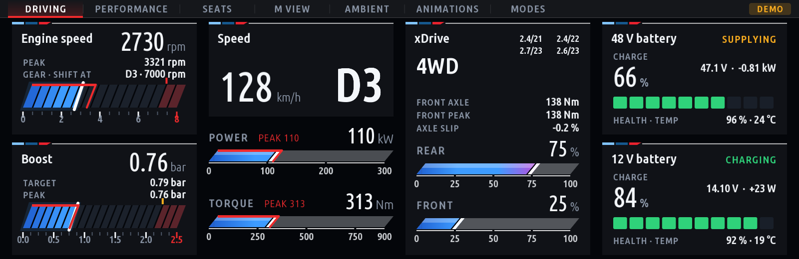
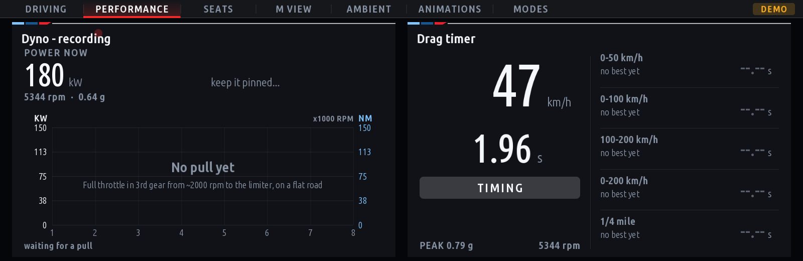
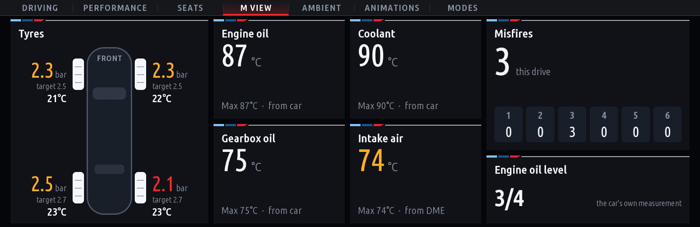
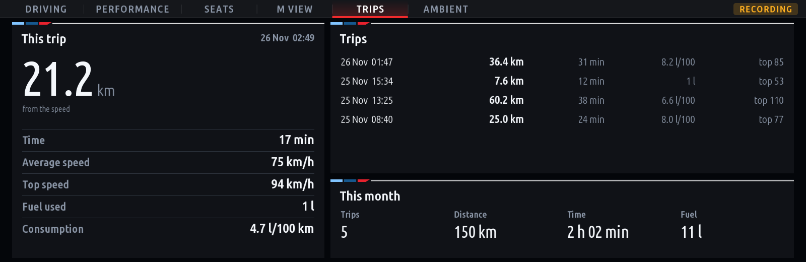
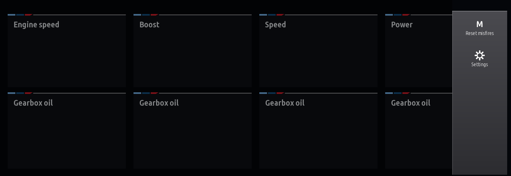
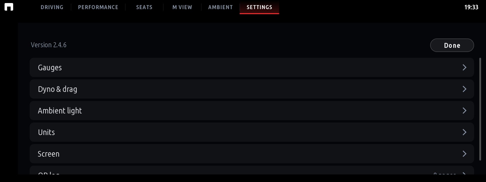

<h1 align="center">Cockpit</h1>

<p align="center">
  <b>Driving data, performance timing, engine health, seats, a trip book and the ambient light: one app for the BMW MGU head unit (iDrive 7).</b><br>
  Drawn by its own GPU renderer. It reads the car; the only things it changes are the seat positions and the ambient light.
</p>

<p align="center">
  
</p>

Cockpit (called **Combo** until 2.7.0) puts the apps used most into tabs of one app, so the head unit runs one process and one diagnostic link instead
of several. It is this repository's only app: a fork of
[cauliflowermossgrape/idrive7-apps](https://github.com/cauliflowermossgrape/idrive7-apps), whose kit (renderer,
runtime, build tools) it is built with. The source repo's own guide (how the head unit works, building, writing your own
app) is in [KIT.md](KIT.md).

**Version 3.0.0.** Developed and tested on a G26 M440i xDrive (B58 with the 48 V mild hybrid, ZF 8HP). Other cars
with the MGU should work for the values they send. The seats are tested on a G26's front seats only.

> **Cockpit moves the front seats with their own motors.** It does this only while the car stands still, and stops at
> once when a seat switch is pressed. It comes without warranty: you use it on your own car at your own risk. Not made
> or supported by BMW.

---

## Contents

- [The tabs](#the-tabs)
- [Screen layouts and controls](#screen-layouts-and-controls)
- [Settings](#settings) (and [only the tabs you need](#only-the-tabs-you-need))
- [Install](#install)
- [What Cockpit reads, and what it doesn't do](#what-combo-reads-and-what-it-doesnt-do)
- [Reporting a problem: the QR log](#reporting-a-problem-the-qr-log) (or [the log uploaded to GitHub](#the-log-uploaded-to-your-github))
- [Development](#development)
- [How the seats were worked out](#how-the-seats-were-worked-out)
- [Thanks](#thanks)
- [Credits and licences](#credits-and-licences)

---

## The tabs

### Driving

The car's live values in four columns of the same size, in M Vitals' look:

- **Engine speed and boost:** with their peaks, the gear and shift point, and the DME's boost target.
- **Speed, power and torque:** with peaks.
- **xDrive:** the mode, the rear / front split, the torque to the front axle (from the transfer case), the wheel slip
  front against rear, and each tyre's pressure and temperature (`2.7/9`). A tyre more than 0.2 bar under the car's
  target is shown in the warning colour.
- **The batteries:** the 48 V battery of a mild hybrid (charge, charging / supplying, voltage, power, health,
  temperature) over the 12 V battery (charge, voltage, power, health, temperature). A car without 48 V gives the
  column to the 12 V battery.

### Performance



- **Virtual Dyno:** a pull in one gear gives power and torque over rpm (from mass × acceleration × speed), with a
  baseline to compare against.
- **Drag timer:** waits for a standing start, then times the splits (0–50, 0–100, 100–200, 0–200 km/h, ¼ mile) and
  keeps your best times. Optional one-foot rollout.

### Seats


Cockpit finds the front seat modules (0x6D driver, 0x6E passenger on a G26) and draws each seat from the side: its
parts sit where the seat really is on its travel (forward / back, height, backrest, tilt, headrest), and a part that
moves lights up, also when the seat's own switches move it.

**Hold an arrow** by a part and that motor moves while you hold it; it stops the moment you let go or slide off, at the
end of its travel, or after 10 s. A press with the controller moves it for a moment.

Each seat has **memory 1 and 2**. Press **Save**, then a slot, to keep the seat's position there; press the slot to
go back to it.

**Easy entry** (Settings > Seats, on by default; off with the Seats tab, Settings > Tabs): press **Save**, then **Easy entry**, to keep the position for getting in
and out. When a front door opens, its seat moves there, after keeping where it was; when the door is closed again, the seat
goes back there. Only the door moves it: nothing happens when the engine starts or stops (start-stop at a light).
**Back** does the same by hand. **Clear** (pressed twice)
deletes the seat's saved positions. A move:

- runs only while the car stands still, on a seat module that reports itself initialised;
- stops at once when any seat switch is pressed, the seat is moved by hand, the car rolls, or **Stop** is pressed;
- keeps every target inside the end stops the seat module has learned, runs every motor that has to move at once, and
  stops each motor itself: the module keeps a motor running until it is told to stop. A seat module that runs one motor
  at a time (it stops the last when the next starts) is found out on the first move and then gets one motor after the
  other, each straight to its target.

Cockpit also listens (reading only) to BMW's own seat interfaces on the head unit. On a G26 the car doesn't offer
BMW's seat functions (`SeatFunction`: the memory buttons, the seat module's own recall) to apps, so Cockpit moves the
motors itself. While a seat moves, the ambient light holds its writes: a door's red blink would otherwise crowd the seat
off the diagnostic link.

### M View



The engine's and gearbox's health at a glance:

- **Tyres:** pressure against the car's target, and temperature in °C. A car that doesn't say its units (a G26) is read as psi and °F only when its own tyre pressures are in psi (2.9.3: one odd reading had turned a 7 °C tyre into −14).
- **Temperatures:** engine oil, coolant, gearbox oil and intake air, each with its maximum this drive and a trace.
- **Misfires:** per cylinder this driving cycle, from the engine's own on-board monitors. *Reset misfires* counts
  from then on; nothing is cleared in the car.
- **Fuel trims and timing:** short and long-term fuel trim, and ignition advance. A long-term trim 10 % from zero
  is shown yellow, 20 % red.

### Trips



A trip book, kept by itself (new in 2.9.0, a first version):

- **A trip is one drive:** it starts when the car is ready to drive and ends a minute after it isn't. Started again
  within 3 minutes (the engine off at a fuel station), the same trip goes on. **End trip** ends it by hand.
- **Each trip:** when, distance, time, average and top speed, the fuel used and the consumption. The distance comes
  from the car's odometer where it sends one (on a G26 the instrument cluster's, 2.9.6) and it agrees with the speed's count (within 20 %), else from the speed; the fuel from the tank's level, so it counts in
  whole litres, a refuel on the way is noticed, and the consumption shows from 20 km on.
- **This month:** trips, distance and fuel.
- **Since refuelling:** distance, fuel and consumption since the last refuel. A refuel is the tank's level rising 3 l
  or more, also a litre at a time with Cockpit running at the pump, or between two drives; the count starts from the
  full tank. Over a tank's worth of driving this is the most exact consumption Cockpit shows.
- Kept on the head unit (the last 1000 trips). Recorded whichever tab shows; with the Trips tab switched off, nothing.

Which of the odometer and fuel values a car offers to apps is logged once as each first comes (`trips signal` lines in
the QR log), and every 10 minutes a `status:` line repeats the latest of each, with whether the renderer can draw
in-page.

### Ambient


Any colour on the ambient light, with animations and a look for each driving mode. This is Ambient config's code,
taken from the source repo at build time.

- **Colour:** the whole car or upper / lower lights separately, with brightness.
- **Animations:** moving scenes.
- **Modes:** a look for each driving mode (Sport, Comfort, Eco Pro, Adaptive).
- **Signals:** a turn signal blinks that side's front door line green, the whole line (both strips on a G26), at an even
  pace of its own; the rear doors keep your colour. An open door can show red.

The ambient light runs from the car's start with the app closed. With Ambient config installed too, the app started
first drives the lights and the other leaves them alone. To leave the lights to another app for good, switch Cockpit's
Ambient tab off (Settings > Tabs, [below](#only-the-tabs-you-need)).

## Screen layouts and controls

Settings > Screen > **Screen layout** picks one of three:

| Layout | Looks like | Tabs | Reset, Settings |
|---|---|---|---|
| **Full screen** (default) | Cockpit draws the whole screen | in the header; Ambient's three pages in a side rail | a side rail on the left; Settings is the header's last tab |
| **Map style** | BMW's map: full screen, only the head unit's home button and status box over the page | in the top strip between them, and a left menu as BMW's map's | a narrow right column as BMW's map's |
| **Standard** | BMW's own title and bottom bar | in the page | BMW's bottom bar, hidden 5 s after the last touch |

**Map style:** the cards use the whole height of the screen (no bar under them), and over the back arrow column too, so the left margin is the same as the right one (BACK and the home button still work). Nothing is drawn on the edges, as on BMW's map, and the page goes up to the top: only the head unit's home button and status box show over it (2.6.9). The pages' names run along the top strip between the two (2.9.2): a touch on one opens it, the page shown underlined in the theme's colour. The bars are drawn as BMW's map draws its menus: the left one a panel from the screen's edge with a row a page (its icon and name, the page shown in BMW's orange-red), the right one a narrow column with each action's icon over its name. A touch on the dimmed page closes a bar. An open bar covers one column and dims the rest of the page.


 

**BMW's pop-ups over Cockpit (in-page, 2.9.8):** with the MGU Store's renderer (`mgu-render`) and its page template
loaded, Cockpit draws inside its own BMW page instead of over the whole HMI. BMW's volume bar, car messages, calls and
the options menu then appear on top of Cockpit, and BMW's own strip (home button, title, status icons) stays at the
top, as on BMW's map. With the renderer's full-screen template (`embed_layout = full`, [MGU Store
#382](https://github.com/robertnisipeanu/mgu-store/pull/382)) Cockpit fills the whole screen under that strip; with
the stock one, the area under BMW's title bar. In **map style** there is no tab row at all (2.9.9): the page starts right
under BMW's strip, and BMW's own title in the strip names the page shown (or Settings while open), as on BMW's pages;
the pages are in the left side bar and on the controller. In the other layouts the tab names sit just below the strip.
BMW's back arrow is drawn over the page's left edge in-page, as on every BMW page: Cockpit keeps that column free (3.0.0). Without the template (or with
another renderer) Cockpit draws over the HMI as before, and BMW's pop-ups stay under it.

**Side bars, by touch:** a touch on the page's left or right edge opens that bar (full screen: on the slim handle). It hides again 5 s after the last touch.

**Side bars, with the iDrive controller:**

- Push **left** for the left bar, push **right** for the right bar (map style). The knob lands on the page you're on.
- Turn to move, press to choose.
- Push the other way to close it.
- A bar opened with the controller stays open until you close it or choose something.

**Elsewhere:** the controller moves along the tabs and the page's buttons as in BMW's own apps. BACK leaves the app.

## Settings



Eight groups:

| Group | What it holds |
|---|---|
| **Tabs** | which tabs Cockpit has: Performance, Seats, M View, Trips and Ambient each switch off (Driving is always there) |
| **Gauges** | engine type, redline, rev scale, boost and torque scales, power and boost sources, peak markers and hold, xDrive card, 48 V battery |
| **Dyno & drag** | weight, body shape, drivetrain loss, the ECU torque overlay, the drag split, one-foot rollout |
| **Ambient light** | decor lights with upper or lower, night dimming, your colour back at each start, the car's own door warning, steering wheel side |
| **Seats** | easy entry when a front door opens (on by default) |
| **Units** | speed, pressure, power, torque, temperature |
| **Screen** | colour theme, layout, bottom bar (Standard), gauges frame rate, renderer, demo data |
| **Log upload** | the log sent to your own GitHub repository as the car stops (off by default, [below](#the-log-uploaded-to-your-github)) |

**Log upload** (how the last upload went; a press sends now) and **QR log** are at the bottom of Settings (see below).

### Only the tabs you need

Settings > **Tabs** switches Performance, Seats, M View, Trips and Ambient off and on again, while Cockpit runs. A tab switched
off is gone from the tab bar and the side bars, its settings are hidden, and it costs nothing:

- **Seats off:** no seat is read and none moves. Easy entry is off too, so another seat app can have the seats.
- **Ambient off:** Cockpit gives every light back to the car and then writes nothing to them. Another ambient app
  (Ambient config, or IterioDev's) has them to itself. Switched off, the ambient light isn't started with the car either.
- **Performance off:** the dyno and the drag timer stop sampling.
- **M View off:** its reads are never made (they run only while the tab shows anyway).
- **Trips off:** nothing is recorded (a trip under way ends).

## Install

You need:

- **A BMW with the MGU head unit (iDrive 7)**, with the MGU Store on it. Root access is needed to install the Store.
  This project does not provide it.
- **From the Store:** the GPU renderer (`idrive7-renderd`, 2.1.18 or newer) and the controller gate
  (`mgu-inputgate`, 1.1.0 or newer). Both come from the source repo.
- **Or the MGU Store's own Renderer (`mgu-render`).** With both renderers installed, Cockpit draws through
  `mgu-render` (2.9.7; before, it took the older one): the one that can draw inside BMW's page, under its pop-ups.

Then add this repository to the MGU Store and install **Cockpit**. When you add the repository, the Store asks what to
follow:

- **Releases:** the ready package from the newest [release](https://github.com/snorkmitzumi/idrive-apps/releases)
  (`cockpit_combo@<version>.tgz`). It holds no BMW software; the head unit links it to the BMW SDK already on it. Choose this
  to get only released versions.
- **Tags:** the head unit builds the newest release tag (`v2.7.0` ...) from source, with the SDK on the unit.
- **The `main` branch:** the head unit builds `main` from source (it reads [`mgu-repo.json`](mgu-repo.json)), so every
  merged change is its next version, before a release.

Cockpit starts with the car (the ambient light needs it running) and shows up in *All apps*.

**Demo data** (Settings > Screen) is on while the car sends nothing, so the screens can be tried parked.

## What Cockpit reads, and what it doesn't do

- **Car signals** over SOME/IP: speed, rpm, gear, torque, temperatures, tyres, driving mode, doors, turn signals, the
  odometer and the fuel in the tank (Trips), and so on.
- **The diagnostic link, read-only:** Cockpit's link only lets reads out:
  - UDS `22` (read by identifier);
  - OBD `01`, `06` and `09` (current data, on-board monitor results, vehicle information).

  Anything else (sessions, writes, routines, clearing faults) is refused before it leaves the head unit, with one
  exception: the seat motors (below). It is used for the values the car doesn't send: front axle torque, battery
  details, gearbox oil, misfires, fuel trims, the seat positions.
- **Reads only while the tab that needs them is on screen,** and none once the car is locked and left, so a parked car
  can sleep. A tab switched off in Settings > Tabs reads nothing at all (Seats off: no door moves a seat either).
- **Nothing leaves the car** unless you switch Settings > Log upload on and give it a repository (below). The package
  asks for the MGU Store's internet (`mguInternet`) only for that.
- **The ambient light is the one thing written:** through the body module, as BMW's own menu does. *Original colour*
  gives the car its own colours back.
- **The seat motors are the one diagnostic write:** `2E D7 08 <motor> <action> <power>` to 0x6D and 0x6E only (the
  seat modules' `STEUERN ARG;MOTOR` job, as ISTA sends it: no session change, no security access), for the five motors
  a G26's seats have. Every other write is refused before it leaves the head unit.

## Load on the head unit

Each tab is drawn only as often as it needs (2.6.4; before, every tab was drawn 60 times a second with the GPU
renderer, a still one too): Driving and Performance at Settings > Screen > **Gauges frame rate** (30 by default; 15 is
the lightest, 60 the smoothest), Seats 10 times a second, M View 5, the ambient tabs only while they change. Once a
minute the log says the app's CPU share, its memory and how many frames it drew (`perf:` lines in the QR log). The log
itself is kept in RAM (2.6.8), with a copy on the head unit's storage at most every 10 minutes, rather than written
to the storage line by line.

## Reporting a problem: the QR log

Settings > **QR log** shows the app's recent log as a few QR codes. Photograph every page; the decoder turns the
photos back into the log:

```bash
pip install zxing-cpp pillow
```

```bash
python3 kit/tools/qrlog_decode.py photo1.jpg photo2.jpg ...
```

The log names what the car answered, which reads it refused, and the app's version.

### The log uploaded to your GitHub

Cockpit can send its log to a GitHub repository of yours as the car stops (2.9.4), so no photos are needed. It is
**off by default**: nothing is sent until you sign in (or give it a repository with SSH) and Upload logs is on.

**Sign in from your phone (2.9.6), no SSH:**

1. Make a **private** repository for the logs (they name your driving times, the odometer and what the car sent).
2. Install the kit's log upload GitHub App on **that repository only** (*Only select repositories*); it asks for
   one permission, Contents: read and write. Or [make your own](#the-github-app) and install that.
3. In the car: Settings > **Log upload** > **Sign in with GitHub**. The screen shows a code and a QR code: scan it (or
   open `github.com/login/device`) on your phone, type the code and allow it. Upload logs switches on by itself.

The car then holds a token of its own, good for 8 hours and renewed by itself for up to 6 months; it reaches only the
repository you installed the app on. Settings > Log upload > **Sign out** forgets it, and GitHub's
[Applications](https://github.com/settings/apps/authorizations) page revokes it from anywhere.

**Or with SSH:** a [fine-grained token](https://github.com/settings/personal-access-tokens/new) for the repository
(Contents: read and write) in `upload.json` in Cockpit's data folder, `/var/opt/public/oap/oap_<uid>/data/` (the
folder that holds `cockpit_combo.log`). It wins over a sign-in.

```json
{ "repo": "you/cockpit-logs", "token": "github_pat_..." }
```

`"branch"` (default: the repository's own) and `"dir"` (default `logs`) are optional.

Cockpit uploads when the car stops (ready to drive, then not), two minutes after it starts (anything a stop without
internet left behind), and at **Send now**. Each upload is a new file,
`logs/cockpit_combo/<month>/<time of its first line>-<version>.log`, holding the lines since the last one, with a VIN
masked. Tokens are never written to the log or shown. An upload GitHub took while its answer got lost on a weak
connection is sent once more under a name with the time added, not refused for good (2.9.5).

The head unit's apps reach the internet only through the MGU Store's **mgu-uplink** (a USB modem, a phone tethered
by USB, or Wi-Fi); the car's own connection isn't open to apps. Without it the row says *No internet* and the lines
wait for the next try.

It is a kit feature, as the QR log is: an app of your own gets it with `"logUpload": true` in its `app.json`
([KIT.md](KIT.md), 6.1).

#### The GitHub App

The sign-in goes through a GitHub App that holds no secret and receives nothing: no webhooks, no server, Contents
only. Its client id is in the kit (`kit/runtime/mgu.js`, `KIT_GITHUB_APP`); an app of your own can name its own with
`"logUpload": { "clientId": "Iv23..." }`.

To make your own: GitHub > Settings > Developer settings > GitHub Apps > **New GitHub App**, any name and homepage,
Webhook **Active** off, Repository permissions > **Contents: Read and write** (nothing else). Once created, tick
**Enable Device Flow** on its General page and save, then **Install App** on your logs repository only. Its Client ID
(`Iv23...`) goes in your `app.json`.

## Development

The code is in [`apps/cockpit_combo/`](apps/cockpit_combo). The ambient light's code is in
[`shared/ambient_config/`](shared/ambient_config), and the kit is in [`kit/`](kit).

| File | What it does |
|---|---|
| `main.js` | the tabs, the layouts, the side bars |
| `draw.js` | the Driving tab |
| `perf.js` | Performance |
| `seats.js`, `seatmod.js`, `seatmove.js`, `seatprobe.js` | Seats (`seatmove.js`: memory and easy entry; `seatprobe.js`: BMW's seat interfaces, read only) |
| `rail.js` | the side bars in map style |
| `mview.js` | M View |
| `trips.js` | Trips: the trip book |
| `signals.js` | the car's signals |
| `reads.js` | the diagnostic reads |
| `values.js` | values and peaks |
| `app.json` | settings, signals and read candidates |

Tests run with Node.js, no car needed:

```bash
node kit/tools/test_combo.js
```

```bash
node kit/tools/test_runtime.js
```

```bash
for t in kit/tools/test_*.js; do node "$t" | tail -1; done
```

`main` changes only through pull requests, for everyone: both test jobs (on Node 8 and the synthetic checks) run on
every pull request and must pass before it can be merged. Fork the repository and open a pull request to contribute.

The head unit runs Node 8: no `?.`, `??`, object spread, `catch {` or `.finally` in the app's code. Building a package
for your own unit needs BMW's app SDK from it; see [KIT.md](KIT.md).

**Releasing:** raise `version` in `apps/cockpit_combo/app.json` in a pull request, merge it, then publish a GitHub release
tagged `v<version>` on `main`. The *Release package* workflow builds `cockpit_combo@<version>.tgz` with
`kit/tools/build.py --no-sdk`, checks that nothing of BMW's SDK is in it, and attaches it to the release, with `mgu-store.json` and the icon
(the title, description and icon the MGU Store shows for a release's app; without them it shows the bare id). For an
earlier release, run that workflow by hand with its tag.

## How the seats were worked out

The seat modules' requests were found by watching BMW's workshop software drive the seat motors, then tested on the
car: which reads give the positions and end stops, the one motor command, what the module does with it (one motor at
a time, a motor runs until it is stopped), and which requests must never be sent. The write-up is
[docs/seats-ista-findings.md](docs/seats-ista-findings.md). No BMW files or traces are in this repository.

## Thanks

Cockpit stands on other people's work. Thank you to everyone behind these projects:

| Project | What Cockpit uses from it |
|---|---|
| [cauliflowermossgrape/idrive7-apps](https://github.com/cauliflowermossgrape/idrive7-apps) | the upstream of this fork: the kit (runtime, renderer, build tools), Ambient config, and M Vitals, Virtual Dyno and Drag Timer, the source of the Driving, Performance and M View tabs. Thanks to cauliflowermossgrape and every contributor there |
| [cauliflowermossgrape/idrive7-8-ssh-root](https://github.com/cauliflowermossgrape/idrive7-8-ssh-root) | root access and the SSH key the kit's deploy scripts use |
| [cauliflowermossgrape/idrive7-privacy-audit](https://github.com/cauliflowermossgrape/idrive7-privacy-audit) | what the stock head unit sends and stores, the background for KIT.md |
| [robertnisipeanu/mgu-store](https://github.com/robertnisipeanu/mgu-store) | the MGU Store that installs Cockpit, and mgu-render, the GPU renderer in `kit/renderd/` (Robert Nisipeanu and IterioDev) |
| [EdiabasX SGBD reference](https://emdzej.github.io/ediabasx-docs-sgbd/) by emdzej | the seat modules' identifiers and their names (FAS_G11 / BFS_G11) |
| [JackieZ123430/idrive7-apps-cn](https://github.com/JackieZ123430/idrive7-apps-cn) | the kit's Simplified Chinese translation (小白151) |
| [Fieldistor/idrive7-apps](https://github.com/Fieldistor/idrive7-apps), [rubenrios/idrive7-apps](https://github.com/rubenrios/idrive7-apps) | the kit's Russian and Spanish translations |
| [ozkl/doomgeneric](https://github.com/ozkl/doomgeneric), [freedoom/freedoom](https://github.com/freedoom/freedoom) | Doom, kept in `third_party/` from the upstream kit |
| [Barlow](https://github.com/jpt/barlow), [Noto CJK](https://github.com/notofonts/noto-cjk) (via [google/fonts](https://github.com/google/fonts)), Ubuntu font | the kit's fonts |

## Credits and licences

The licences differ by part; [NOTICE.md](NOTICE.md) has the full list.

- **Cockpit** (`apps/cockpit_combo/`): © 2026 snorkmitzumi, [PolyForm Noncommercial 1.0.0](apps/cockpit_combo/LICENSE). Free for any
  noncommercial use: your own car, study, a hobby. Selling it, charging to install it, or using it in a product needs
  written permission; ask in the repository's issues.
- **The seat findings** ([docs/seats-ista-findings.md](docs/seats-ista-findings.md)): © 2026 snorkmitzumi,
  [CC BY-NC 4.0](LICENSES/CC-BY-NC-4.0.txt).
- **Kit, renderer and source apps:** [cauliflowermossgrape/idrive7-apps](https://github.com/cauliflowermossgrape/idrive7-apps),
  MIT licence (see [LICENSE](LICENSE)). Cockpit is built on its kit and takes Ambient config's code from it. M Vitals,
  Virtual Dyno and Drag Timer are the source of its Driving and Performance tabs. That code stays MIT
  ([apps/cockpit_combo/NOTICE](apps/cockpit_combo/NOTICE)). The GPU renderer in `kit/renderd/` is GPL-3.0-or-later, Doom GPL-2.0.
- **Seat module identifiers:** from the public [EdiabasX SGBD reference](https://emdzej.github.io/ediabasx-docs-sgbd/)
  (FAS_G11 / BFS_G11).
- **No code** from IterioDev's apps (PolyForm Strict) is used.
- BMW, iDrive, ISTA and the car's own software, fonts and texts belong to BMW. This is an unofficial project, not
  affiliated with BMW. Use it at your own risk.
